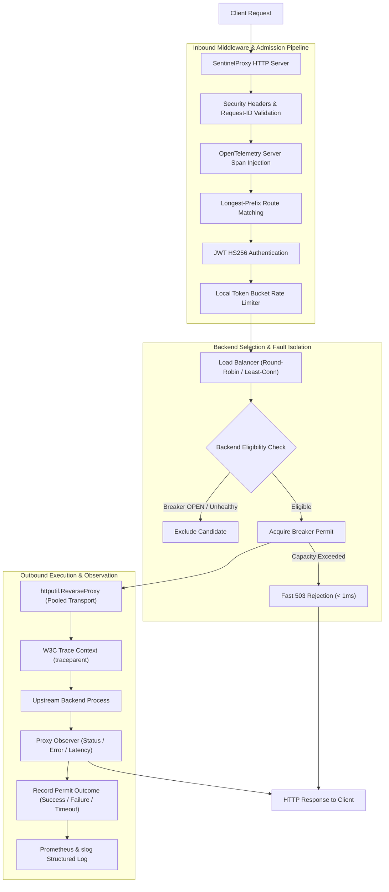

# SentinelProxy

> **A high-concurrency, fault-isolating API gateway written in Go.**  
> Featuring deterministic longest-prefix routing, sliding-window circuit breakers with admission permits, local token-bucket rate limiting, strict HMAC-SHA256 JWT validation, OpenTelemetry/W3C distributed tracing, Prometheus observability, and zero-downtime hot configuration reloads.

[](https://golang.org)
[](https://github.com/AnushKamble/SentinelProxy/actions/workflows/ci.yml)
[](https://github.com/AnushKamble/SentinelProxy)
[](LICENSE)

---

## Architecture Overview



---

## Core Capabilities

- **Real Reverse Proxying:** Powered by Go's battle-tested `net/http/httputil.ReverseProxy` with pooled keep-alive transports, aggressive connection reuse, and response streaming.
- **Sliding-Window Circuit Breakers:** Per-route/backend sliding time windows (10-bucket ring buffer) with explicit `TryAcquire` admission permits. Fast-fails broken upstreams with `503 Service Unavailable` in under 1ms, preserving timeout budgets and preventing thread starvation.
- **Failover & Least-Connections Balancing:** Concurrency-safe load balancing with real-time in-flight tracking. If one backend fails, traffic immediately and transparently diverts 100% to surviving healthy candidates without client downtime.
- **Monotonic Token-Bucket Rate Limiter:** High-throughput in-memory token bucket evaluated in **52 ns/op (0 allocations)**. Extracts client identity hierarchically: authenticated JWT `sub` > verified `X-Forwarded-For` (via trusted CIDR check) > peer IP.
- **Strict JWT Verification:** HMAC-SHA256 verification using `golang-jwt/jwt/v5`. Enforces cryptographic algorithm allowlists (rejects `none` and asymmetric confusion attacks) and validates `exp`, `nbf`, `iss`, and `aud` claims.
- **OpenTelemetry & W3C Distributed Tracing:** Injects W3C `traceparent` headers into upstream requests, correlating end-to-end distributed traces across microservices. Emits JSON logs correlating `request_id` and `trace_id`.
- **Prometheus Observability:** Native Prometheus exporter with strict bounded label cardinality (`route_id`, `method`, `status_class`) to prevent memory-exhaustion attacks.
- **Zero-Downtime Hot Reloads:** Atomic pointer swapping (`atomic.Pointer[RuntimeSnapshot]`) with candidate configuration validation. If an invalid configuration is introduced, it is safely rejected while retaining the last-known-good state and existing circuit breaker history.

---

## Measured Benchmark Results

All benchmarks were empirically measured on an AMD Ryzen 9 8940HX (32 cores) running Go 1.27.0 on Windows 11. Results represent **5 repeated runs per condition**:

| Condition | Median Throughput | p50 Latency | p95 Latency | p99 Latency | Success Rate | Operational Significance |
|---|---|---|---|---|---|
| **A: Healthy Baseline** | **5,517.94 req/s** | **1.25 ms** | **2.38 ms** | **4.10 ms** | **100.00%** | Full-pipeline baseline under normal operation |
| **B: Degraded (Breaker Disabled)** | **156.54 req/s** | **50.94 ms** | **51.75 ms** | **52.60 ms** | **0.00%** | Workers starved waiting on 50ms upstream delay |
| **C: Degraded (Breaker Enabled)** | **27,098.53 req/s** | **0.00 ms** | **1.01 ms** | **1.89 ms** | **0.00%** | **173x throughput gain** via sub-millisecond fast-fail |
| **D: Isolated Route Protection** | **6,236.05 req/s** | **1.13 ms** | **2.44 ms** | **4.21 ms** | **100.00%** | Zero blast radius: sibling route remains 100% healthy |

### Microbenchmarks (Go `testing.B`)

```
BenchmarkRouterMatch-32                  7,202,815    167.3 ns/op     0 B/op    0 allocs/op
BenchmarkCircuitBreakerAcquireRelease-32 10,867,989   108.5 ns/op    48 B/op    1 allocs/op
BenchmarkRateLimiterAllow-32             25,910,427    52.34 ns/op     0 B/op    0 allocs/op
```

---

## Quick Start Guide

### Option 1: Native One-Command Live Demo (Recommended)

Run the self-contained native multi-process demonstration script (starts Gateway, 2 mock backends, demonstrates load balancing, injects faults, demonstrates circuit breaker failover, recovers, and inspects live Prometheus metrics):

```powershell
# Windows (PowerShell)
.\scripts\run_demo.ps1
```

```bash
# Linux / macOS (Bash)
chmod +x ./scripts/*.sh
./scripts/run_demo.sh
```

### Option 2: Docker Compose

Spin up SentinelProxy, two mock backend instances, and Prometheus:

```bash
docker compose -f deploy/docker-compose.yml up --build
```

- **Gateway Endpoint:** `http://localhost:8080/api/echo`
- **Prometheus UI:** `http://localhost:9090`
- **Gateway Health:** `http://localhost:8080/healthz`
- **Metrics Endpoint:** `http://localhost:8080/metrics`

---

## Fault Injection and Resilience Scenarios

SentinelProxy includes 10 fully automated end-to-end integration scenarios verifying all fault modes (`tests/integration/scenarios_test.go`):

1. **Healthy Baseline:** 200 OK across multiple routes and backends.
2. **Breaker Trip on 5xx:** 100% 500 error trips breaker to OPEN at exact threshold.
3. **Slow Backend Timeout:** Gateway timeout budget enforced; breaker trips on timeouts.
4. **Backend Crash (Connection Refused):** Connection resets return 502, tripping breaker.
5. **Failover to Surviving Backend:** Failing backend excluded; surviving backend handles 100% of traffic.
6. **Fast 503 Budget Preservation:** Broken route returns fast 503 in <1ms without burning timeout budgets.
7. **Blast Radius Isolation:** Outage in Route A does not affect Route B.
8. **Half-Open Self-Healing:** Backend recovery followed by 2 successful probe requests restores breaker to CLOSED.
9. **Last-Known-Good Reload Safety:** Malformed config reload rejected; existing traffic continues uninterrupted.
10. **Rate Limit & Auth Isolation:** 401 Unauthorized and 429 Rate Limited responses never count as upstream failures.

Execute the scenario verification suite:

```bash
go test -v ./tests/integration -run TestScenario
```

---

## Project Structure

```
SentinelProxy/
├── bench/                  # High-throughput workload generator & benchmark suite
├── cmd/
│   ├── loadgen/            # CLI load generation tool
│   ├── mock-backend/       # Controllable mock backend with fault injection
│   └── sentinelproxy/      # Gateway entrypoint
├── configs/                # Strict YAML configuration templates
├── deploy/                 # Dockerfile, Docker Compose & Prometheus setup
├── docs/                   # Architecture, threat model, failure semantics, limitations
│   ├── decisions/          # Architecture Decision Records (ADRs 0001-0006)
│   ├── architecture.md     # Deep-dive system architecture
│   ├── configuration.md    # YAML configuration contract & reference
│   ├── threat-model.md     # Security threat model & mitigation strategies
│   ├── failure-semantics.md# Status codes, error mapping & state transitions
│   ├── benchmark-protocol.md# Benchmark methodology & empirical data
│   └── limitations.md      # Engineering trade-offs & future scope
├── internal/
│   ├── admin/              # Health & admin handlers (/healthz, /readyz, /-/status)
│   ├── app/                # Server lifecycle, dependency wiring, and middleware
│   ├── auth/               # HMAC-SHA256 JWT verifier
│   ├── balancer/           # Round-robin and least-connections balancers
│   ├── circuitbreaker/     # Sliding-window circuit breaker & admission permits
│   ├── config/             # Strict YAML validation, snapshots, and file watcher
│   ├── health/             # Active prober with hysteresis
│   ├── middleware/         # Security headers & request-ID validation
│   ├── mock/               # Mock backend engine
│   ├── proxy/              # httputil.ReverseProxy & pooled transport
│   ├── ratelimit/          # Monotonic token-bucket rate limiter
│   ├── router/             # Longest-prefix route matcher
│   └── telemetry/          # OpenTelemetry tracing, Prometheus metrics, structured logs
├── results/                # Raw empirical benchmark & scenario JSON/CSV outputs
├── scripts/                # Multi-process native demo and benchmark scripts
└── tests/                  # Integration & security test suites
```

---

## Verification Commands

```bash
# Run unit tests across all packages
go test -v ./internal/...

# Run all end-to-end integration scenarios
go test -v ./tests/integration/...

# Run security header & request ID validation tests
go test -v ./tests/security/...

# Run Go microbenchmarks
go test -bench . -benchmem -run "^$" ./bench

# Static code analysis
go vet ./...
```

---

## License

This project is licensed under the MIT License. See [LICENSE](LICENSE) for details.
