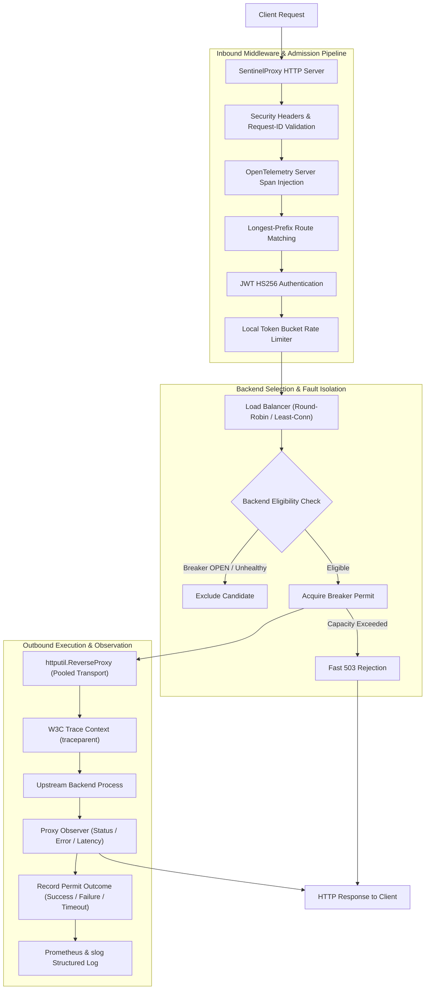
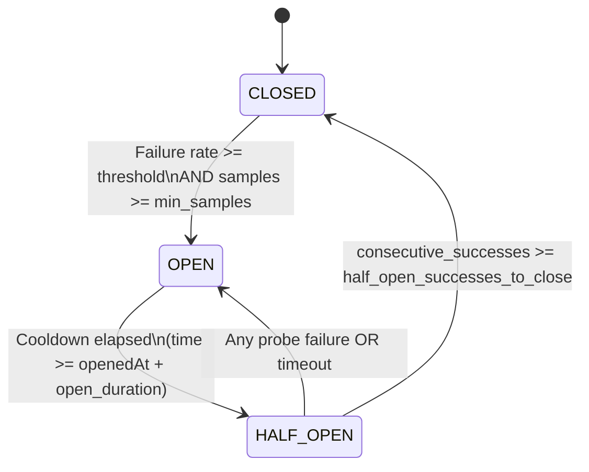
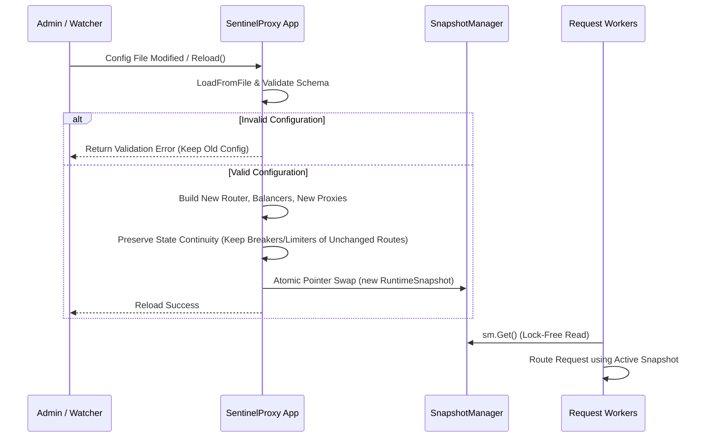

# SentinelProxy Architecture Specification

SentinelProxy is an edge API gateway built in Go designed for fault isolation, high concurrency, and resilient proxying. It integrates deterministic longest-prefix routing, load balancing, per-route/backend sliding-window circuit breakers, token-bucket rate limiting, strict JWT authentication, OpenTelemetry/W3C distributed tracing, Prometheus metrics, and zero-downtime hot configuration reloads.

---

## 1. High-Level System Architecture

---

## 2. Request Processing Pipeline

Every request arriving at SentinelProxy follows a strict linear pipeline with zero counter or permit leaks:

1. **Request-ID Normalization & Validation (`internal/middleware/request_id.go`):**
   - Extracts existing `X-Request-ID` or generates a cryptographically random 128-bit hex UUID.
   - Replaces invalid or malformed request IDs.
   - Injects the request ID into the request context and outbound response header.

2. **Inbound OpenTelemetry Span (`internal/telemetry/tracing.go`):**
   - Extracts incoming W3C trace context or starts a new root server span.
   - Sets span attributes: `http.method`, `http.route`, `http.target`.

3. **Deterministic Longest-Prefix Router (`internal/router/router.go`):**
   - Matches `req.URL.Path` against route prefixes sorted descending by prefix length.
   - If no route matches: returns `404 Not Found` immediately.
   - If path matches but HTTP method is disallowed: returns `405 Method Not Allowed` with an `Allow` header listing permitted methods.
   - Reserved paths (`/healthz`, `/readyz`, `/metrics`, `/-/status`) bypass custom routes and cannot be shadowed.

4. **Authentication Check (`internal/auth/jwt.go`):**
   - If `auth_required: true`, extracts `Authorization: Bearer <token>`.
   - Validates HMAC-SHA256 signature against the configured secret key.
   - Enforces claims: `exp` (expiration), `nbf` (not before), `iss` (issuer), and `aud` (audience).
   - If invalid or expired: returns `401 Unauthorized`. Neither rate limiters nor circuit breakers are penalized.

5. **Token Bucket Rate Limiting (`internal/ratelimit/limiter.go`):**
   - Derives client key using priority hierarchy:
     1. Authenticated JWT `sub` claim (if present).
     2. Validated client IP from `X-Forwarded-For` (only if remote IP is in `trusted_proxy_cidrs`).
     3. Direct TCP `r.RemoteAddr`.
   - Refills tokens using monotonic time calculations.
   - If tokens available: consumes 1 token.
   - If exhausted: returns `429 Too Many Requests` with `Retry-After` header. Does not penalize upstream circuit breakers.

6. **Load Balancing & In-Flight Accounting (`internal/balancer/balancer.go`):**
   - Backends are evaluated against an eligibility checker (`backendEligibilityChecker`):
     - Active Health Check Registry: must be marked healthy.
     - Circuit Breaker: must NOT be in `StateOpen`.
   - Algorithms:
     - `round_robin`: Atomic round-robin index across eligible backends.
     - `least_connections`: Selects candidate with minimal in-flight requests, breaking ties with round-robin index.
   - Acquires an in-flight counter token; guaranteed cleanup via defer closure.

7. **Circuit Breaker Admission Permit (`internal/circuitbreaker/permit.go`):**
   - Calls `breaker.TryAcquire()`:
     - `CLOSED`: Grants permit immediately.
     - `OPEN`: Rejects immediately with `503 Service Unavailable`.
     - `HALF_OPEN`: Allows up to `half_open_max_probes` concurrent probe requests. Excess requests receive fast 503.

8. **Reverse Proxy & Timeout Enforcement (`internal/proxy/proxy.go`):**
   - Forwarding uses standard Go `net/http/httputil.ReverseProxy`.
   - Per-route context deadline enforces timeout budget.
   - Strips hop-by-hop headers (`Keep-Alive`, `TE`, `Upgrade`, `Proxy-Authorization`).
   - Injects W3C `traceparent` carrier header into upstream request.
   - Sets `Host` header to upstream target host.

9. **Outcome Classification & Metrics (`internal/app/app.go`):**
   - Observer records HTTP status code, streaming completion, or network failure.
   - Breaker permit is finalized:
     - Success (HTTP 2xx, 3xx, 4xx): `permit.RecordSuccess()`
     - Counted Failure (HTTP 500, 502, 503, 504, network error): `permit.RecordFailure()`
     - Timeout (context deadline exceeded): `permit.RecordFailure()`
   - Prometheus metrics updated with bounded label cardinality.
   - JSON structured log emitted correlating `request_id` and `trace_id`.

---

## 3. Circuit Breaker State Machine

### Invariants:
1. **Sliding Time Window:** Fixed ring buffer of time buckets (default 10 buckets across 10 seconds).
2. **Deterministic Epoch Eviction:** Stale buckets are lazily cleared when the current epoch advances beyond the window.
3. **Probe Concurrency Guard:** When in `HALF_OPEN`, at most `half_open_max_probes` concurrent requests are allowed to probe the backend.
4. **No Metric or Counter Leaks:** Every permit acquired must call either `RecordSuccess()`, `RecordFailure()`, or `Release()` exactly once.

---

## 4. Atomic Configuration Hot Reload

SentinelProxy supports atomic hot reconfiguration without restarting the server or dropping connections:

- **Candidate Validation Before Swap:** The new file is parsed and validated in full. Any syntax error, invalid regex, malformed URL, or duplicate route ID immediately aborts the reload, preserving the last-known-good configuration.
- **State Continuity:** Breaker counters, open states, and token-bucket token balances for unchanged backends are preserved across reloads.
- **Lock-Free Read Access:** Handlers read the active immutable configuration snapshot via `atomic.Pointer[RuntimeSnapshot]`.
